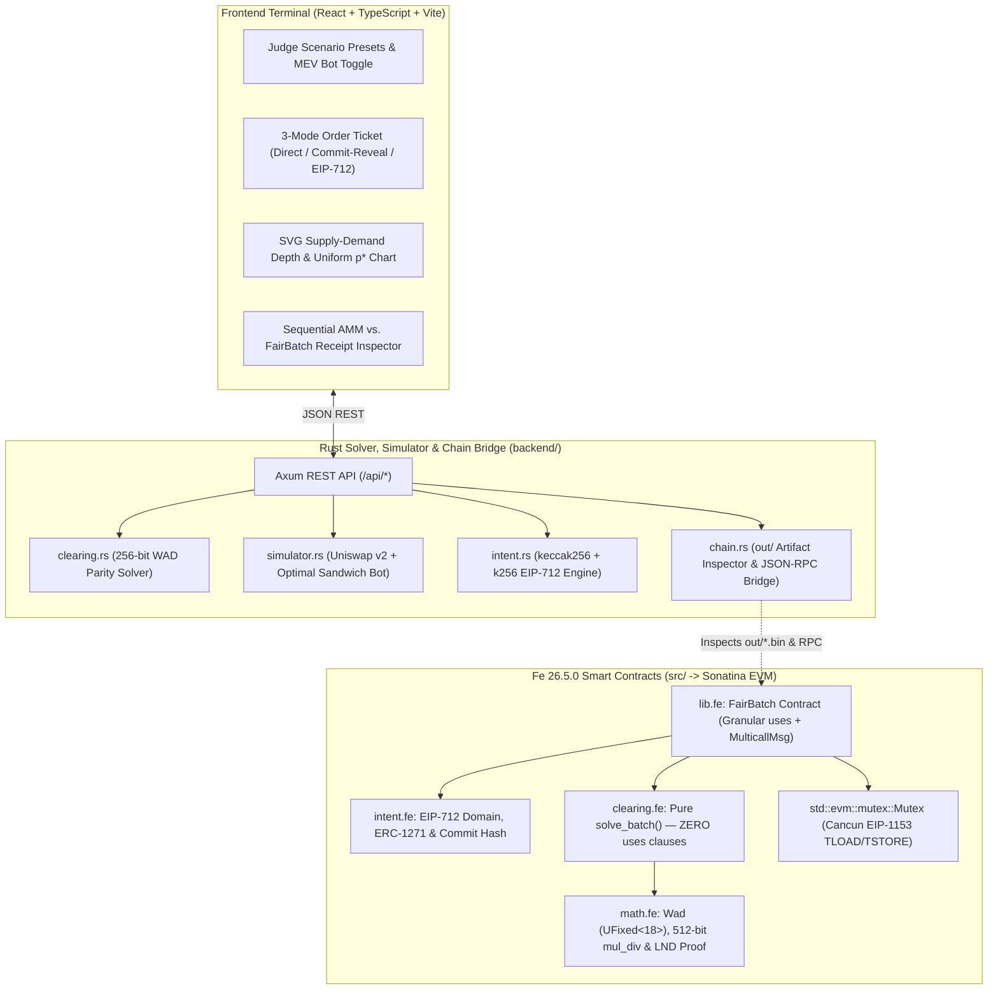

# FairBatch

**Pitch:** FairBatch is an MEV-resistant uniform-clearing batch exchange and Hybrid Coincidence-of-Wants (CoW) + Function-Maximizing AMM (FM-AMM) written in **Fe 26.5.0** whose pricing engine is statically proven pure by Fe's capability system (`0` `uses` clauses), eliminating intra-batch sandwich extraction (`$0.00` bot profit) and arrival-order slippage for on-chain traders and liquidity providers.

---

## The problem

On sequential constant-product AMMs ($x \cdot y = k$), swaps execute one-by-one in the exact order a block builder sequences them. This creates three structural failures for DeFi users and liquidity providers:

1. **Arrival-Order Unfairness:** Five honest users submitting identical `1 WETH -> USDC` swaps in the same block receive five different execution prices purely from mempool ordering — the 5th trader suffers nearly **5x** the price impact of the 1st trader.
2. **Intra-Block MEV Sandwich Extraction:** Searchers detect pending swaps, front-run to push the price against victims, and back-run immediately after. Against five `1 WETH` sells into a `100 WETH / 300,000 USDC` Sequential AMM (`30 bps` fee), an optimal sandwich bot extracts **`$1,802.26 USDC`** directly from user execution quality.
3. **Loss-Versus-Rebalancing (LVR) on Passive LPs:** Sequential arbitrageurs walk down the AMM price curve and capture the entire inframarginal surplus while leaving $k = x \cdot y$ unchanged net of fees.

---

## Approach

FairBatch replaces sequential per-transaction execution with **discrete uniform-price batch auctions** backed by an embedded **Function-Maximizing AMM (FM-AMM, Canidio & Fritsch 2023)** passive liquidity pool:

1. **Three Order Submission Modes (`Open` -> `Reveal / Intent` -> `Settle` -> `Claim`):**
   - **Direct Limit Orders (`submitDirectOrder`):** Single-step limit orders during the Open window.
   - **Sealed Commit-Reveal (`commitOrder` + `revealOrder` + `slashUnrevealed`):** Hides `(side, amount_in, limit_price, salt)` behind `keccak256` during the Commit window, backed by a `Wei` reveal bond that is refunded on valid reveal or slashed if left unrevealed (eliminating the "last-revealer" free-option game).
   - **Gasless / Solver-Relayed EIP-712 Signed Intents (`submitSignedIntent`):** Off-chain typed-data intents verified on-chain via `std::evm::eip712::Domain` and `std::evm::signature::is_valid_signature_now` (supporting both canonical EOA `secp256k1` signatures and **ERC-1271** smart-contract wallets, with sequential nonces and `Timestamp` deadlines).

2. **Closed-Form Hybrid CoW + FM-AMM Uniform Clearing (`src/clearing.fe`):**
   - Normalizes arbitrary ERC-20 decimals ($\le 18$, specifically **18-decimal WETH** and **6-decimal USDC**) into 18-decimal `core::fixed::Wad` units.
   - Sorts active sellers ascending by minimum limit price and active buyers descending by maximum limit price using Fe 26.5's `core::sort::{sort, reverse, dedup_sorted}`.
   - Solves for the unique market-clearing uniform price:
     $$p^* = \frac{R_y + 2 D_y}{R_x + 2 S_x}$$
     (degenerating cleanly to pure P2P $p^* = D_y / S_x$ when $R_x = R_y = 0$, and pinning $p^* = p_{\text{limit}}$ with exact floor-rounded **pro-rata partial fills** whenever a marginal limit tier crosses equilibrium).
   - **Peer-to-Peer CoW First:** Overlapping buyer and seller volume $\min(S_x, D_y / p^*)$ crosses directly peer-to-peer with **0% price impact**.
   - **LVR-Resistant Reserve Absorption:** Only the net batch imbalance hits the passive pool $(R_x, R_y)$ at its *post-trade* marginal price $R_y' / R_x' = p^*$, strictly growing the constant-product invariant via AM-GM:
     $$R_x' R_y' - R_x R_y = \frac{(p^* R_x - R_y)^2}{4 p^*} \ge 0$$
   - **Zero Intra-Batch Sandwich Profit:** Even if an MEV bot injects both a front-run leg and a back-run leg into the same batch, both fill at the **identical scalar price $p^*$**, yielding **$\le \$0.00$ profit** before gas.

3. **Pull-Over-Push Settlement & Full-Stack Verification Workbench:**
   - `settleBatch()` performs **zero external token transfers** — it records floor-rounded raw-atom entitlements in `StorageMap` so a single blacklisted Circle USDC address can never revert batch settlement for other traders. Users claim via EIP-1153 `Mutex`-guarded `claim()` or batch-claim across epochs via `std::evm::multicall::MulticallMsg`.
   - Paired with **`fairbatch-backend`** (`backend/`, Rust + Axum + `k256` EIP-712 solver, Uniswap v2 + Optimal MEV Sandwich simulator, and RPC artifact bridge) and an **Institutional DeFi Exchange Terminal** (`frontend/`, React + TypeScript + TailwindCSS + custom SVG Supply/Demand depth & $p^*$ visualizer).

---

## Fe highlight

FairBatch is designed around **Fe 26.5.0's capability-based effect system (`uses`)** and **Sonatina EVM backend**:

1. **Compiler-Enforced Pure Pricing (`0` `uses` clauses in `src/clearing.fe`):**
   In Solidity, nothing prevents a complex batch-pricing routine from accidentally reading mutable slot state, inspecting `block.timestamp`/`msg.sender`, or making external calls. In FairBatch, every function in [`src/clearing.fe`](./src/clearing.fe) and [`src/math.fe`](./src/math.fe) — including `solve_batch` — declares **zero `uses` clauses**. The Fe 26.5 compiler statically proves at compile time that clearing math is a deterministic pure function of reserves and orders:

```fe
// Excerpt from src/clearing.fe — ZERO `uses` clauses: statically forbidden from
// touching storage, external calls, event logs, or EVM execution context (`Ctx`).
pub fn solve_batch(
    rx_raw: u256,
    ry_raw: u256,
    base_decimals: u8,
    quote_decimals: u8,
    orders: MemSlice<Order>,
) -> ClearingOutput {
    let rx_norm = normalize_amount(rx_raw, base_decimals)
    let ry_norm = normalize_amount(ry_raw, quote_decimals)
    // ...
    // Sort active sellers ascending by p_min and buyers descending by p_max
    sort(mut sellers)
    sort(mut buyers)
    reverse(mut buyers)

    let sell_tiers = build_tiers(sellers.as_slice())
    let buy_tiers = build_tiers(buyers.as_slice())
    let eq = find_equilibrium(
        rx: rx_norm,
        ry: ry_norm,
        sell_tiers: sell_tiers.as_slice(),
        buy_tiers: buy_tiers.as_slice(),
    )
    // Pass 1 & Pass 2: 512-bit mul_div / mul_div_ceil directional bounds
    // guaranteeing raw-atom solvency & R_x' * R_y' >= R_x * R_y across all u256 inputs.
```

2. **Granular Capability Projection, Custom Effect Injection (`with`) & Cancun EIP-1153 `Mutex` ([`src/lib.fe`](./src/lib.fe)):**
   Each entrypoint declares only the exact storage projections and capabilities it touches, uses `with (BatchClock = ...)` for deterministic clock injection in tests, locks reentrancy in **~300 gas** via EIP-1153 `TLOAD`/`TSTORE` (`std::evm::mutex::Mutex`), and leverages Sonatina's code-tail immutables (`CODESIZE` + `CODECOPY`) for `MarketConfig` and `eip712::Domain`:

```fe
// Verbatim excerpt from src/lib.fe (lines 911–954) — narrow `uses` projection + EIP-1153 Mutex
Claim { batch_id, order_id } -> (u256, u256)
uses (ctx, mut call, mut log, config, mut receipts, mut guard)
{
    guard.lock()

    var rec = receipts.get(key: (batch_id, order_id))
    assert!(rec.settled, "Order not settled")
    assert!(!rec.claimed, "Order already claimed")
    let caller = ctx.caller()
    assert!(rec.trader == caller, "Not order owner")

    let out_base = rec.payout_base
    let out_quote = rec.payout_quote
    rec.claimed = true
    receipts.set(key: (batch_id, order_id), value: rec)

    if out_base > 0 {
        safe_transfer(
            token: config.base_token,
            receiver: caller,
            amount: out_base,
        )
    }
    if out_quote > 0 {
        safe_transfer(
            token: config.quote_token,
            receiver: caller,
            amount: out_quote,
        )
    }

    log.emit(
        OrderClaimed {
            batch_id,
            order_id,
            trader: caller,
            payout_base: out_base,
            payout_quote: out_quote,
        },
    )

    guard.unlock()
    (out_base, out_quote)
}
```

---

## Architecture



| Path | Responsibility |
| :--- | :--- |
| [`fe.toml`](./fe.toml) | `fair_batch` ingot manifest (`version = "0.1.0"`, Fe `26.5.0`). |
| [`src/types.fe`](./src/types.fe) | `#[abi]` structs (`Order`, `SignedOrder`, `Commitment`, `FillOutcome`, `BatchSummary`, `OrderReceipt`), events, constants (`MAX_ORDERS_PER_BATCH = 64`, `MIN_ORDER_AMOUNT = 1_000`). |
| [`src/math.fe`](./src/math.fe) | Pure `Wad` (`UFixed<18>`) helpers, 18d/6d scaling, 512-bit `full_mul` / `mul_div` / `mul_div_ceil`, and `verify_lnd_invariant`. |
| [`src/clearing.fe`](./src/clearing.fe) | **Zero-effect (`uses ()`)** Hybrid CoW + FM-AMM uniform batch solver using `core::sort::{sort, reverse, dedup_sorted}`, marginal tier pro-rata allocation, and directional rounding bounds. |
| [`src/intent.fe`](./src/intent.fe) | `keccak_words` commit-reveal hashing + EIP-712 `Domain` / `SignedOrder` digest & `is_valid_signature_now` (EOA + ERC-1271). |
| [`src/storage.fe`](./src/storage.fe) | `MarketConfig`, `PoolState`, and `BatchMeta` storage records. |
| [`src/lib.fe`](./src/lib.fe) | `FairBatch` contract: LP seeding/withdrawal, 3 order modes, bond slashing, `settleBatch`, `Mutex`-guarded `claim`, `MulticallMsg`, and `BatchClock` effect trait. |
| [`src/mock_erc20.fe`](./src/mock_erc20.fe) | Configurable-decimal `MockERC20` with Circle USDC-style `blacklisted` compliance hooks for settlement-liveness testing. |
| [`src/tests.fe`](./src/tests.fe) | **37 Fe tests** covering unit clearing math, permutation/LND/solvency properties, zero-MEV sandwich proofs, `with (BatchClock = ...)` tests, and multi-actor EVM integration/revert tests. |
| [`backend/`](./backend) | Rust `fairbatch-backend` crate (`clearing.rs`, `simulator.rs`, `intent.rs`, `chain.rs`, `state.rs`, `api.rs`, `main.rs`) — **29 tests**. |
| [`frontend/`](./frontend) | React + TypeScript + TailwindCSS institutional exchange terminal + resilient browser fallback engine (`fallbackEngine.ts`) — **13 Vitest tests** (`273.67 kB` production bundle). |
| [`config/networks.json`](./config/networks.json) | Cancun EVM network & canonical token registry (`sepolia` `11155111`, `hoodi` `560048`, `mainnet` `1`, `anvil` `31337`). |
| [`deployments/`](./deployments) | Structured public deployment manifests ([`sepolia.template.json`](./deployments/sepolia.template.json) & auto-generated `sepolia.json`). |
| [`docs/`](./docs) | [`PROJECT_STRUCTURE.md`](./docs/PROJECT_STRUCTURE.md) (folder map & Sepolia setup guide) & [`RESEARCH_AND_FEASIBILITY.md`](./docs/RESEARCH_AND_FEASIBILITY.md) (T1–T5 proofs & Cancun opcode audit). |
| [`scripts/`](./scripts) | [`check_setup.ps1`](./scripts/check_setup.ps1), [`deploy_sepolia.ps1`](./scripts/deploy_sepolia.ps1), [`prepare_deployment.ps1`](./scripts/prepare_deployment.ps1), [`verify_local_anvil.ps1`](./scripts/verify_local_anvil.ps1), & [`start_stack.ps1`](./scripts/start_stack.ps1). |

---

## Build and test

Clone the repository:

```sh
git clone https://github.com/jubayir-hub-69/FairBatch.git
cd FairBatch
```

### 1. Smart Contracts (Fe `26.5.0`)

Install Fe `v26.5.0` (or later) via [`feup`](https://fe-lang.org/getting-started/installation/):

```sh
curl -fsSL https://raw.githubusercontent.com/argotorg/fe/master/feup/feup.sh | bash -s -- --version v26.5.0
```

Format-check, type-check, run all **37 contract tests**, and build EVM artifacts into `out/`:

```sh
fe --version      # Verified with: fe 26.5.0 (3dab95f)
fe fmt --check
fe check
fe test           # 37 passed; 0 failed
fe build          # Emits out/FairBatch.{bin,runtime.bin,abi.json}
```

### 2. Rust Solver, MEV Simulator & API (`backend/`)

Requires a stable Rust toolchain (`rustc` / `cargo` 1.80+):

```sh
cd backend
cargo clippy --all-targets -- -D warnings
cargo test        # 29 passed; 0 failed (19 unit + 10 Axum HTTP E2E tests)
cargo run         # Starts live solver & chain bridge on http://127.0.0.1:3001
```

### 3. Web Exchange Terminal (`frontend/`)

Requires Node.js 20+ and `npm`:

```sh
cd frontend
npm install
npm test          # 13 passed; 0 failed (Vitest + Testing Library component journeys)
npm run build     # TypeScript check + production Vite bundle (0 warnings/errors)
npm run dev       # Opens http://localhost:5173 (proxies /api -> 127.0.0.1:3001)
```

### 4. Local Cancun Anvil Verification & Ethereum Sepolia Deployment (`scripts/`)

See [`docs/PROJECT_STRUCTURE.md`](./docs/PROJECT_STRUCTURE.md) for the step-by-step Sepolia `.env` guide:

```powershell
# 1. Verify workspace layout, compiled out/ artifacts & .env readiness:
powershell -NoProfile -ExecutionPolicy Bypass -File scripts/check_setup.ps1

# 2. Offline Sepolia EIP-1559 raw-tx & calldata dry-run (zero network calls):
powershell -NoProfile -ExecutionPolicy Bypass -File scripts/deploy_sepolia.ps1 -DryRun

# 3. Ephemeral local Cancun Anvil (Chain ID 31337) bytecode & 5-seller verification:
powershell -NoProfile -ExecutionPolicy Bypass -File scripts/verify_local_anvil.ps1

# 4. Live Ethereum Sepolia (Chain ID 11155111) deployment (after setting DEPLOYER_PRIVATE_KEY in .env):
powershell -NoProfile -ExecutionPolicy Bypass -File scripts/deploy_sepolia.ps1
```

---

## Demo

### Reproducible Flagship Benchmark: 5 Users Swap `1 WETH -> USDC` (With & Without MEV Sandwich Bot)

Pool initial state: **`100 WETH` (`18` decimals) / `300,000 USDC` (`6` decimals)** (spot price `$3,000.00 USDC/WETH`). Five retail traders (Alice, Bob, Carol, Dave, Eve) each submit a `1.0 WETH` sell order in the same batch/block:

| Metric | Sequential AMM (`x*y=k`, 30 bps, No Bot) | Sequential AMM + Optimal Sandwich Bot | **FairBatch Uniform Clearing (With OR Without Bot)** |
| :--- | :---: | :---: | :---: |
| **Alice (#1) Execution Price** | `$2,961.29 USDC` | `$2,598.18 USDC` | **`$2,727.272727 USDC`** (`2,727,272,727` raw) |
| **Eve (#5) Execution Price** | `$2,739.32 USDC` | `$2,407.79 USDC` | **`$2,727.272727 USDC`** (`2,727,272,727` raw) |
| **Intra-Batch Price Spread (#1 vs #5)** | `$221.97 / WETH` | `$190.39 / WETH` | **`$0.000000 / WETH` (100% Uniform)** |
| **MEV Sandwich Bot Profit** | — | **`+$1,802.26 USDC`** | **`$0.00 USDC` (`<= 0` after floor rounding)** |
| **Total Payout to 5 Honest Users** | `14,244.89 USDC` | `12,508.43 USDC` | **`13,636.363635 USDC`** (`13,636,363,635` raw) |
| **Post-Batch LP Invariant Growth ($\Delta k$)** | `+0.04%` (fees only; exposed to LVR) | `+0.09%` | **`+68,181.82` (`+0.227%` LND surplus)** |

> **Balanced CoW Crossing Highlight:** When `5 WETH` of sellers meet `15,000 USDC` of buyers in the same batch, FairBatch clears **100% peer-to-peer at `$3,000.00 USDC/WETH`** (`0.00%` slippage, `R_x' = 100 WETH`, `R_y' = 300,000 USDC`).

### Empirical Local Cancun Anvil EVM Metrics (`fe 26.5.0` Sonatina Backend)

| Artifact / Operation | Measured Value | Notes |
| :--- | :--- | :--- |
| `out/FairBatch.bin` (Creation Bytecode) | `22,376 bytes` | `22,600 bytes` including ABI-encoded constructor args |
| `out/FairBatch.runtime.bin` (Static Runtime) | `21,191 bytes` | `86.23%` of EIP-170 `24,576`-byte limit (`13,991` instructions) |
| Deployed Runtime Code (`cast code`) | `21,543 bytes` | Includes `352 bytes` of Sonatina `CODECOPY` immutables (`87.66%` EIP-170) |
| `FairBatch` Contract Creation Gas | `4,827,646 gas` | Measured live on local Cancun Anvil (`0x49a9fe`) |
| 5-Seller `settleBatch()` Execution Gas | `1,093,156 gas` | Sorts, solves $p^*$, updates reserves & writes 5 receipts (~3.0% of 36M block) |
| Cancun / Shanghai Opcodes Emitted | `PUSH0=346, MCOPY=14, TLOAD=6, TSTORE=14` | Verified via `cast disassemble` on `out/FairBatch.runtime.bin` |

### Live Ethereum Sepolia Deployment (`Chain ID 11155111`)

FairBatch and its companion `18`-decimal `fWETH` + `6`-decimal `fUSDC` test tokens are deployed, seeded (`100 fWETH / 300,000 fUSDC`), and verified live on **Ethereum Sepolia** (full manifest in [`deployments/sepolia.json`](./deployments/sepolia.json)):

| Contract / Action | Address / Value | Transaction Hash | Block | Gas Used | Sepolia Etherscan |
| :--- | :--- | :--- | :---: | :---: | :--- |
| **`FairBatch` Exchange** | `0x60122518eccbeeb247cd42b0201f244432c7600d` | `0x017de9a5938f8c114db1515c17e9415a05375854bfe688a9c0f203f3f97c40d0` | `12156617` | `33,989,460` | [View Contract](https://sepolia.etherscan.io/address/0x60122518eccbeeb247cd42b0201f244432c7600d) |
| **`fWETH` (`18` decimals)** | `0xe72678fb21267fbb5c02c59496f04a86a7d8d56b` | `0xb236855f2e244088b50c362826ef2bb504a0eb3b826acc3302c9fe837172ca8e` | `12156615` | `2,192,556` | [View Token](https://sepolia.etherscan.io/address/0xe72678fb21267fbb5c02c59496f04a86a7d8d56b) |
| **`fUSDC` (`6` decimals)** | `0x0384fb6158fb2e5ea021af6f8fa3e81daeb075f0` | `0x67f7d5c3402f68db9a68dd708a602eb61e40cf55f2eee3e1a82e79f81195ed2f` | `12156616` | `2,192,556` | [View Token](https://sepolia.etherscan.io/address/0x0384fb6158fb2e5ea021af6f8fa3e81daeb075f0) |
| **`seedReserves(100e18, 300000e6)`** | `R_x = 100 fWETH`, `R_y = 300,000 fUSDC` | `0x402adb9c6fba6d31b2cfc701c47b3f0e2b3f57c1bf0ed9de35990212b50c2dfd` | `Mined` | `747,631` | [View Seed Tx](https://sepolia.etherscan.io/tx/0x402adb9c6fba6d31b2cfc701c47b3f0e2b3f57c1bf0ed9de35990212b50c2dfd) |

- **Deployer Account:** [`0x9AFe5CeF11fC10756faef213f7A30D9873B5d372`](https://sepolia.etherscan.io/address/0x9AFe5CeF11fC10756faef213f7A30D9873B5d372)
- **Verified On-Chain `domainSeparator()`:** `0xe718c08c5b766d15ba49f7fb773d29aae922828821cfe8a674a056a8c2b37dca` (`active_batch_id = 1`, `21,543` deployed runtime bytes)

### Interactive CLI + Web Demo Steps

1. Start the Rust solver in terminal 1 (`cd backend && cargo run`) and the React terminal in terminal 2 (`cd frontend && npm run dev`), or open the frontend standalone (automatically engages the resilient client-side `Standalone Browser Engine` badge if the backend is offline).
2. Click **"5 Users Swap ETH -> USDC"** in the Scenario Bar, toggle **"Inject MEV Sandwich Bot"** ON, and click **"Settle Batch Now"** to inspect the live SVG Supply/Demand intersection at $p^* = \$2,727.27$ and per-trader Sequential AMM vs. FairBatch execution receipts.
3. Switch to **"Balanced CoW Crossing (0% Slippage)"** or **"Marginal Limit Tier (Pro-Rata Partial Fill)"**, test **Sealed Commit-Reveal** (including bond slashing on unrevealed orders) and **1-Click EIP-712 Signed Intents**, then execute **Multicall Batch Claim** in the Claims Panel.

---

## Limitations

Full mathematical derivations and EVM deployment analysis are documented in [`docs/RESEARCH_AND_FEASIBILITY.md`](./docs/RESEARCH_AND_FEASIBILITY.md). Key scope boundaries, security assumptions, and Ethereum Testnet vs. Mainnet considerations:

1. **Cancun EVM Hardfork Requirement (`TLOAD`/`TSTORE`, `MCOPY`, `PUSH0`):**
   `fe 26.5.0` compiles `std::evm::mutex::Mutex` to EIP-1153 transient storage opcodes (`TLOAD` `0x5c`, `TSTORE` `0x5d`) and emits `MCOPY` (`0x5e`) and `PUSH0` (`0x5f`). FairBatch is **fully compatible with Ethereum Mainnet (`1`), Sepolia (`11155111`), Hoodi (`560048`), and local Foundry Anvil (`31337`)**, and will revert with `INVALID` on deprecated pre-Cancun networks (*Goerli, Holesky, Rinkeby, Ropsten* — all sunset).
2. **Ethereum Testnet Limitations vs. Mainnet Production Requirements:**
   - *Counterparty Scarcity & Spot Drift:* Public testnets lack organic two-sided retail flow and profit-seeking arbitrageurs; repeated one-sided test batches lean on the passive $(R_x, R_y)$ FM-AMM pool and drift internal spot unless a keeper rebalances against external reference prices.
   - *Settlement Keeper Liveness:* `settleBatch()` is permissionless after `reveal_deadline` but requires an external transaction (`fairbatch-backend` keeper on testnet; solver bundles or Gelato/Chainlink Automation on mainnet).
   - *Public Mempool Metadata & Bond Sizing:* Commit-reveal conceals order parameters during `commit_window`, but public ERC-20 `approve()` sizes can leak upper bounds unless paired with infinite approvals or private HTTPS **EIP-712 Signed Intents**. Reveal bond `min_bond` deters retail free-option non-reveal when sized above expected window volatility, whereas institutional-sized orders on mainnet should use private solver intents or notional-proportional bonds.
3. **Token Standard Scope:**
   FairBatch supports standard exact-transfer ERC-20 tokens with decimals $\le 18$ (verified on 18-decimal WETH9 and 6-decimal Circle USDC with blacklist hooks isolated via pull-based `claim()`). Fee-on-transfer and rebasing tokens (e.g., raw `stETH` instead of wrapped `wstETH`) are intentionally excluded and must be wrapped before deposit.
4. **Bounded Batch Size & Audit Status:**
   Each batch caps intake at `MAX_ORDERS_PER_BATCH = 64` orders and `64` commitments to guarantee deterministic settlement well inside Ethereum L1 block gas limits. FairBatch is deployed and verified live on **Ethereum Sepolia (`0x60122518eccbeeb247cd42b0201f244432c7600d`)**; before **Ethereum Mainnet (`Chain ID 1`)** launch, an independent security audit of both contract logic and `fe 26.5.0` Sonatina codegen, plus an optional Chainlink/TWAP circuit breaker during low-TVL bootstrap, are recommended.

---

## Declaration

- **Pre-existing work:** Started from the official contest template [`fe-lang/builders-challenge-starter`](https://github.com/fe-lang/builders-challenge-starter) at commit `f9d9aa9` (`LICENSE`, initial `.gitignore`, `.github/workflows/ci.yml`, `README.md`, `SUBMISSION.md`, and the example `Vault` contract). All FairBatch smart contracts (`src/*.fe`, `fe.toml`), the Rust solver & MEV simulation backend (`backend/**`), the React + TypeScript exchange terminal (`frontend/**`), mathematical & feasibility research (`docs/RESEARCH_AND_FEASIBILITY.md`), and local verification scripts (`scripts/**`) were built from scratch during the contest window (after November 3, 2026).
- **Third-party code:** Zero third-party smart contract code was copied into `src/` — FairBatch relies exclusively on Fe `26.5.0`'s built-in `core` and `std` ingots. The off-chain `backend/` and `frontend/` workspaces use standard open-source crates and packages via Cargo (`axum`, `tokio`, `tower-http`, `serde`, `serde_json`, `sha3`, `k256`, `hex` — MIT/Apache-2.0) and npm (`react`, `react-dom`, `lucide-react`, `vite`, `typescript`, `tailwindcss`, `vitest`, `@testing-library/react`, `jsdom` — MIT/Apache-2.0). The FM-AMM equilibrium pricing formula implements the public academic model of Canidio & Fritsch (2023, arXiv:2307.02074).
- **AI assistance:** Built with AI coding assistance (Google DeepMind Antigravity multi-agent workflow) under human engineering direction for Fe 26.5.0 contract implementation, differential rounding/solvency verification between Fe and Rust, institutional UI/UX implementation, and documentation drafting. Every mathematical proof, compiler diagnostic, 37-test Fe suite, 29-test Rust suite, 13-test Vitest frontend suite, and local Cancun Anvil bytecode execution was empirically executed and verified against the local `fe 26.5.0 (3dab95f)`, Rust, Node.js, and Foundry toolchains.

---

## Team

Built by **[@jubayir-hub-69](https://github.com/jubayir-hub-69)** ([`jubayir-hub-69/FairBatch`](https://github.com/jubayir-hub-69/FairBatch)) for the [Fe Builders Challenge](https://fe-lang.org/contest/).

---

## License

Licensed under the **Apache License, Version 2.0** (OSI-approved). See [`LICENSE`](./LICENSE) for the full license text.
