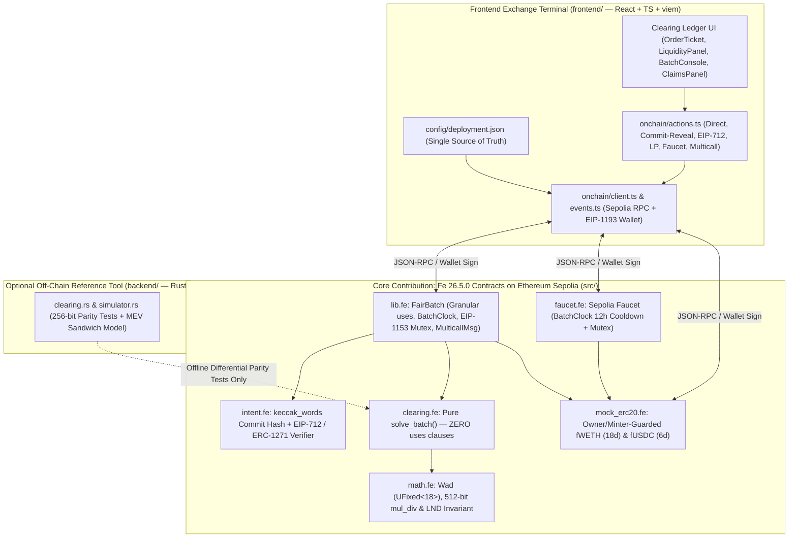

# FairBatch

**Pitch:** FairBatch is an MEV-resistant uniform-clearing batch exchange and Hybrid Coincidence-of-Wants (CoW) + Function-Maximizing AMM (FM-AMM) written in **Fe `26.5.0`** whose pricing engine (`src/clearing.fe`) is statically proven pure by Fe's capability system (`0` `uses` clauses), eliminating intra-batch sandwich extraction (`$0.00` bot profit) and arrival-order slippage on Ethereum Sepolia.

---

## The Problem

On sequential constant-product AMMs ($x \cdot y = k$), swaps execute one-by-one in block-builder order, causing three structural problems:

1. **Arrival-Order Unfairness:** Five identical `1 WETH -> USDC` swaps in one block receive five progressively worse prices solely due to transaction ordering.
2. **Intra-Block MEV Sandwich Extraction:** Searchers front-run pending swaps and back-run immediately after. Against five `1 WETH` sells into a `100 WETH / 300,000 USDC` sequential AMM (`30 bps` fee), an optimal sandwich bot extracts `$1,802.26 USDC` from user execution quality (verified in `backend/src/simulator.rs`).
3. **Loss-Versus-Rebalancing (LVR):** Sequential arbitrageurs capture inframarginal surplus while leaving $k = x \cdot y$ unchanged net of fees.

---

## Approach

FairBatch replaces sequential execution with discrete **uniform-price batch auctions** (`Open` -> `Reveal` -> `Ready to Settle` -> `Settled`) backed by an embedded **Function-Maximizing AMM (FM-AMM, Canidio & Fritsch 2023)** passive liquidity pool:

1. **Three Order Submission Modes (`src/lib.fe`, `src/intent.fe`):**
   - **Direct Limit Orders (`submitDirectOrder`):** Single-step limit orders during the `Open` window.
   - **Sealed Commit-Reveal (`commitOrder` + `revealOrder` + `slashUnrevealed`):** Hides `(side, amount_in, limit_price, salt)` behind `keccak256` during `Open`, backed by a `Wei` reveal bond. Honest reveals refund the bond with a `200,000`-gas budget (compatible with smart wallets and EIP-7702 delegated accounts). Unrevealed commitments can be slashed permissionlessly after `reveal_deadline`, paying the forfeited ETH bond directly to the slasher caller and emitting `CommitmentSlashed(batch_id, commit_id, trader, slasher, forfeited_bond)`. Pending commitments reserve batch capacity so direct orders or intents cannot crowd out honest revealers.
   - **EIP-712 Signed Intents (`submitSignedIntent`):** Off-chain typed-data intents verified on-chain via `std::evm::eip712::Domain` and `std::evm::signature::is_valid_signature_now` (supporting EOA `secp256k1` and **ERC-1271** smart-contract wallets, with sequential nonces, batch binding, and `Timestamp` deadlines) during `Open` or `Reveal`.

2. **Pure Uniform Hybrid CoW + FM-AMM Clearing (`src/clearing.fe`, `src/math.fe`):**
   - Normalizes raw token amounts ($\le 18$ decimals, deployed with `18`-decimal `fWETH` and `6`-decimal `fUSDC`) to 18-decimal `Wad` (`UFixed<18>`).
   - Solves for the unique uniform clearing price:
     $$p^* = \frac{R_y + 2 D_y}{R_x + 2 S_x}$$
     (degenerating to pure P2P $p^* = D_y / S_x$ when $R_x = R_y = 0$, and pinning $p^* = p_{\text{limit}}$ with floor-rounded pro-rata fills when a marginal limit tier crosses equilibrium).
   - Overlapping buyer and seller flow matches peer-to-peer (CoW) with zero price impact; only the net imbalance clears against passive reserves $(R_x, R_y)$, growing $k' = R_x' R_y' \ge R_x R_y$ (Liquidity-Nondecreasing invariant, verified on-chain with 512-bit `full_mul`).

3. **Pull-Over-Push Claims, Protected Liquidity, and Testnet Faucet:**
   - `settleBatch()` executes **zero external token transfers** — entitlements are written to `OrderReceipt` storage so a blacklisted token holder cannot revert batch settlement. Traders withdraw via `claim(batch_id, order_id)` or batch-claim atomically with `multicall(bytes[])` (`MulticallMsg`).
   - **FM-AMM Liquidity (`addLiquidity`, `addLiquidityLocked`, `removeLiquidity`):** Enforces caller-supplied slippage bounds (`min_shares`, `min_base`, `min_quote`), pulls only the matched reserve ratio on subsequent adds (leaving excess on the over-supplied side untouched in the LP's wallet), rounds strictly in favor of the pool, burns `MINIMUM_LIQUIDITY = 1_000` shares to `Address::zero()` on first deposit, and supports optional LP time-locking via `addLiquidityLocked` / `getLiquidityLock`.
   - **Access-Controlled Tokens & Sepolia Faucet (`src/mock_erc20.fe`, `src/faucet.fe`):** `fWETH` and `fUSDC` restrict `mint` to `owner` and an authorized `minter` (`Faucet`), and restrict `mintAndApprove`, `setMinter`, and `setBlacklisted` to `owner`. The standalone `Faucet` contract is pre-funded with `2,000 fWETH` and `1,000,000 fUSDC` and drips `1 fWETH + 100 fUSDC` per wallet every `12 hours`.

---

## Why Fe

FairBatch's core contract suite (`src/*.fe`) is built around **Fe `26.5.0`** features rather than Solidity-style patterns translated line-by-line:

| Fe `26.5.0` Feature | Where Used | Concrete Engineering Benefit |
| :--- | :--- | :--- |
| **Zero-effect pure functions (`uses ()`)** | [`src/clearing.fe`](./src/clearing.fe), [`src/math.fe`](./src/math.fe) | Every pricing, sorting, and invariant helper declares zero `uses` clauses — the compiler statically forbids storage reads/writes, external calls, logs, and `Ctx` access inside `solve_batch`. |
| **Granular capability projections (`uses (...)`)** | [`src/lib.fe`](./src/lib.fe), [`src/faucet.fe`](./src/faucet.fe), [`src/mock_erc20.fe`](./src/mock_erc20.fe) | Each message handler explicitly names only the storage maps and effects it reads or mutates (e.g., `Claim` cannot access `pool` or `batches`; `GetReserves` cannot access `ctx` or `call`). |
| **Custom effect trait & `with (...)` injection** | `BatchClock` in [`src/lib.fe`](./src/lib.fe) & [`src/faucet.fe`](./src/faucet.fe); `MockClock` in [`src/tests.fe`](./src/tests.fe) | Production handlers inject `with (BatchClock = EvmClock { ts: ctx.timestamp() })` (monomorphized with virtually zero bytecode overhead), while `fe test` injects `MockClock` to deterministically test batch phase transitions, slashing windows, LP lock expiry, and 12-hour faucet cooldowns. |
| **Typed messages (`msg`), `#[selector]`, `#[payable]`, `recv`** | [`src/lib.fe`](./src/lib.fe), [`src/faucet.fe`](./src/faucet.fe), [`src/mock_erc20.fe`](./src/mock_erc20.fe), [`src/tests.fe`](./src/tests.fe) | Sol-compatible ABI dispatch (`FairBatchMsg`, `FaucetMsg`, `MockErc20Msg`, `MulticallMsg`) plus wildcard payable fallback `recv { #[payable] _ ... }` in `TraderActor`. |
| **Enums, `Option`, and pattern matching** | `Side` in [`src/types.fe`](./src/types.fe) & [`src/lib.fe`](./src/lib.fe); `Option<Address>` in [`src/intent.fe`](./src/intent.fe) & [`src/tests.fe`](./src/tests.fe) | Exhaustive `match` over `Side::from_u8` and `recover_order_signer` results without sentinel integers. |
| **Strongly-typed EVM domain units & fixed-point** | `Wei`, `Timestamp`, `Duration`, `Address` across [`src/storage.fe`](./src/storage.fe), [`src/lib.fe`](./src/lib.fe), [`src/faucet.fe`](./src/faucet.fe); `core::fixed::Wad` (`UFixed<18>`) in [`src/math.fe`](./src/math.fe) & [`src/clearing.fe`](./src/clearing.fe) | Prevents unit-confusion bugs between seconds, timestamps, wei values, and 18-decimal price ratios at compile time. |
| **Fe `core` & `std` standard libraries** | `std::evm::mutex::Mutex` (EIP-1153 `TLOAD`/`TSTORE`), `std::evm::eip712::Domain`, `std::evm::signature::is_valid_signature_now`, `std::evm::multicall::MulticallMsg`, `std::evm::erc20::safe_transfer*`, `core::sort::{sort, reverse, dedup_sorted}`, `core::num::{full_mul, isqrt, mul_div, mul_div_ceil}`, compile-time `core::bytes::keccak` | Zero external contract libraries copied into `src/`; reentrancy locks compile directly to ~300-gas Cancun transient storage (`TLOAD`/`TSTORE`), and `MarketConfig` / `Domain` immutables compile to Sonatina code-tail `CODECOPY`. |

### Real Fe `26.5.0` Workarounds & Rough Edges Encountered

1. **No timestamp-warp cheatcode in `fe test` (`std::evm::Evm`):** `evm.timestamp()` is read-only inside `#[test]` EVM tests. Workaround: we defined the `BatchClock` effect trait in [`src/lib.fe`](./src/lib.fe) and reused it in [`src/faucet.fe`](./src/faucet.fe) so batch phases, slash eligibility, LP lock expiry, and faucet cooldown expiry are tested deterministically via `with (BatchClock = MockClock { ... })`, while EVM integration tests that immediately settle deploy with `Duration::zero()` windows.
2. **No secp256k1 signing helper in `fe test`:** EOA EIP-712 tests (`evm_eip712_eoa_signed_intent_gasless_relayer`, `evm_revert_replayed_eip712_intent`) hardcode an offline-signed `(r, s, v)` vector tied to `FairBatch`'s deterministic `CREATE2` address; any change to `FairBatch.bin` or `MockERC20.bin` requires recomputing that test vector. (ERC-1271 intent tests avoid this via `TraderActor::AuthorizeDigest`.)
3. **Ascending-only `core::sort::sort`:** `core::sort::sort` sorts ascending by `Ord`, so buyer orders are sorted ascending and then reversed with `core::sort::reverse` ([`src/clearing.fe`](./src/clearing.fe)).
4. **Hex literals reject underscore separators:** Decimal literals allow `_` (`1_000_000`), whereas hex literals with underscores (e.g., `0x7702_CAFE`) fail parsing (`error[1-0001]`), so tests use contiguous hex (`0x7702CAFE`).
5. **Windows CRLF handling in `fe fmt --check`:** `fe fmt --check` treats `\r\n` vs `\n` as a full-file diff on Windows checkouts. Fixed by enforcing `*.fe text eol=lf` in [`.gitattributes`](./.gitattributes).
6. **All contracts in the ingot compile to `out/`:** `fe build` emits bytecode/ABI artifacts for test-only helper contracts (`TraderActor`, `MaliciousReentrantERC20` in `src/tests.fe`) alongside production contracts (`FairBatch`, `Faucet`, `MockERC20`).

---

## Architecture

The live exchange frontend connects **directly to Ethereum Sepolia via `viem`** using [`config/deployment.json`](./config/deployment.json) as the single source of truth — **no REST backend is required**. The Rust crate in [`backend/`](./backend) is kept strictly as an optional off-chain reference/parity verifier and sequential-AMM MEV sandwich simulator (not the core contribution).



| Path | Responsibility |
| :--- | :--- |
| [`fe.toml`](./fe.toml) | `fair_batch` ingot manifest (`version = "0.1.0"`, Fe `26.5.0`). |
| [`src/lib.fe`](./src/lib.fe) | `FairBatch` exchange contract: batch lifecycle, 3 order modes, commit-slot reservation, slasher-paid `slashUnrevealed`, pull-based `claim`, `MulticallMsg`, slippage-protected LP add/remove with `MINIMUM_LIQUIDITY` burn & optional locking, `BatchClock` trait. |
| [`src/clearing.fe`](./src/clearing.fe) | **Zero-effect (`uses ()`)** Hybrid CoW + FM-AMM uniform batch solver, marginal-tier pro-rata rationing, directional rounding bounds, and 512-bit solvency/LND assertions. |
| [`src/math.fe`](./src/math.fe) | Pure `Wad` (`UFixed<18>`) helpers, 18d/6d scaling, 512-bit `full_mul`/`mul_div` comparisons, `verify_lnd_invariant`, and `compute_initial_lp_shares`. |
| [`src/intent.fe`](./src/intent.fe) | `keccak_words` commit-reveal hashing, EIP-712 `SignedOrder` hashing, and `is_valid_signature_now` (EOA + ERC-1271) with zero-trader, batch, nonce, and deadline checks. |
| [`src/storage.fe`](./src/storage.fe) | `MarketConfig`, `PoolState`, `BatchMeta`, and `LiquidityLock` storage records. |
| [`src/types.fe`](./src/types.fe) | `Side` enum, `#[abi]` structs, `#[event]` definitions, and protocol constants (`MAX_ORDERS_PER_BATCH = 64`, `MIN_ORDER_AMOUNT = 1_000`, `MINIMUM_LIQUIDITY = 1_000`). |
| [`src/faucet.fe`](./src/faucet.fe) | Standalone Sepolia `Faucet` (`1 fWETH + 100 fUSDC` / `12h`) with `BatchClock` cooldown helpers and EIP-1153 `Mutex`. |
| [`src/mock_erc20.fe`](./src/mock_erc20.fe) | Access-controlled `MockERC20` (`owner`/`minter`-restricted `mint`, owner-only `mintAndApprove`/`setMinter`/`setBlacklisted`) deployed as `fWETH` (18d) and `fUSDC` (6d). |
| [`src/tests.fe`](./src/tests.fe) | **69 Fe tests** covering clearing math, properties, MEV zero-profit proof, `MockClock` transitions (batches, LP locks, faucet, slashing), full EVM lifecycles, 64-order settlement, and security revert boundaries. |
| [`config/deployment.json`](./config/deployment.json) | Single source of truth for live Ethereum Sepolia contract addresses, token metadata, market windows, and faucet config. |
| [`deployments/sepolia.json`](./deployments/sepolia.json) | Full Sepolia deployment manifest with tx hashes, block numbers, gas usage, and Etherscan links. |
| [`frontend/`](./frontend) | React 18 + TypeScript + TailwindCSS + `viem` exchange terminal connected directly to Sepolia (**17 Vitest tests**). |
| [`backend/`](./backend) | Optional Rust reference solver & sequential-AMM MEV simulator (**30 Cargo tests**, see [`backend/README.md`](./backend/README.md)). |
| [`scripts/`](./scripts) | PowerShell deployment and verification scripts (`deploy_sepolia.ps1`, `prepare_deployment.ps1`, `check_setup.ps1`). |
| [`docs/`](./docs) | [`PROJECT_STRUCTURE.md`](./docs/PROJECT_STRUCTURE.md), [`RESEARCH_AND_FEASIBILITY.md`](./docs/RESEARCH_AND_FEASIBILITY.md), and [`design/CLEARING_LEDGER.md`](./docs/design/CLEARING_LEDGER.md). |

---

## Build, Test & Demo (Reproducible From a Clean Clone)

### 1. Clone

```sh
git clone https://github.com/Asif2902/FairBatch.git
cd FairBatch
```

### 2. Smart Contracts (Fe `26.5.0` — Core Contribution)

Install Fe `v26.5.0` via [`feup`](https://fe-lang.org/getting-started/installation/):

```sh
curl -fsSL https://raw.githubusercontent.com/argotorg/fe/master/feup/feup.sh | bash -s -- --version v26.5.0
```

Verify formatting, type-checking, all **69 Fe tests**, and build EVM bytecode + ABI artifacts into `out/`:

```sh
fe --version      # Verified with: fe 26.5.0 (3dab95f)
fe fmt --check
fe check
fe test           # 69 passed; 0 failed
fe build          # Emits out/{FairBatch,Faucet,MockERC20}.{bin,runtime.bin,abi.json}
```

### 3. Live Sepolia Web Terminal (`frontend/`)

Requires Node.js 20+ and `npm`. No `.env` file or local backend is needed — addresses are loaded directly from [`config/deployment.json`](./config/deployment.json):

```sh
cd frontend
npm ci
npm test          # 17 passed; 0 failed (Vitest)
npm run build     # tsc -b && vite build
npm run dev       # Opens http://localhost:5173 connected to Ethereum Sepolia
```

In the browser on Ethereum Sepolia (Chain ID `11155111` with MetaMask or any EIP-1193 wallet):
1. Connect your wallet to **Sepolia** and click **Claim Faucet** (`1 fWETH + 100 fUSDC` every 12 hours).
2. Submit orders in any of the three modes (**Direct**, **Sealed Commit-Reveal**, or **EIP-712 Signed Intent**) during the active batch window.
3. Add flexible or optionally time-locked LP liquidity in the **Liquidity** panel and test partial/unlocked withdrawal.
4. Once `reveal_deadline` passes, click **Settle Batch** (permissionless) to clear all orders at one uniform price $p^*$, slash any unrevealed commitment to collect its ETH bond bounty, and claim payouts individually or via **Multicall Claim**.

### 4. Optional Off-Chain Rust Reference Verifier (`backend/`)

Requires stable Rust (`cargo` 1.80+):

```sh
cd backend
cargo clippy --all-targets -- -D warnings
cargo test        # 30 passed; 0 failed (20 unit + 10 integration/parity tests)
```

---

## Live Ethereum Sepolia Deployment & Verified End-to-End Run

All contracts were compiled from frozen Fe `26.5.0` source and deployed from a single deployer account [`0x7d9Cb2994D86B6a4e65761B5d81DADa69ce54a7f`](https://sepolia.etherscan.io/address/0x7d9Cb2994D86B6a4e65761B5d81DADa69ce54a7f) on **Ethereum Sepolia (`Chain ID 11155111`)** (recorded in [`config/deployment.json`](./config/deployment.json) and [`deployments/sepolia.json`](./deployments/sepolia.json)):

### Deployed Contracts & Setup

| Contract / Setup Action | Address / Details | Transaction Hash | Block | Gas Used |
| :--- | :--- | :--- | :---: | :---: |
| **`fWETH` (`18` decimals)** | [`0xe9903189bf3e418759feb26f11a7d1c99be0e556`](https://sepolia.etherscan.io/address/0xe9903189bf3e418759feb26f11a7d1c99be0e556) | `0x5b3f18005b6d6344eef187eec18456300a1aaf26f0a1cb4241b527b9a21d990b` | `12176749` | `2,676,774` |
| **`fUSDC` (`6` decimals)** | [`0xbd2c54af6dd7e5e14d5b97d393eb2c8e2e8ebcca`](https://sepolia.etherscan.io/address/0xbd2c54af6dd7e5e14d5b97d393eb2c8e2e8ebcca) | `0xd15e031b8141c028dcefdaeecbb2dce1366c976dca004b0f9a11ab290aba0fbe` | `12176750` | `2,676,774` |
| **`FairBatch` Exchange** | [`0x6fa21b7ada82e8b04fca51fdc60793c3fd80265f`](https://sepolia.etherscan.io/address/0x6fa21b7ada82e8b04fca51fdc60793c3fd80265f) | `0x6ed5ad0144aedeb3c5cd4e5d91d54ccda9d2d8b58d64a5467e757573d8c9ff91` | `12176751` | `36,300,761` |
| **`Faucet` (`1 fWETH + 100 fUSDC / 12h`)** | [`0xe355220e8e9a650d082d49f130f0bfe344a792c7`](https://sepolia.etherscan.io/address/0xe355220e8e9a650d082d49f130f0bfe344a792c7) | `0x8a2886ba04e1986c8257011ab23f596808d704374acd5f1753d0ad0238078b48` | `12176752` | `2,294,323` |
| **`setMinter(Faucet)` on `fWETH` & `fUSDC`** | Authorizes `Faucet` as token minter | `0xe10069956ae7f3ab6bb2139831d4f0db89583e5ea51ba788d85fb2e3f1d607e3` / `0xadb15e76c7fc89c474b17a7abe179072c6e172819c6a190dde959fd61ec43097` | `Mined` | — |
| **Fund `Faucet` (`2,000 fWETH`, `1,000,000 fUSDC`)** | Pre-funded faucet custody | `0xbb3b600a737b14e67bd1d19603879d62aa28587fa6cb89729ed09c1ddd2f179c` / `0x13e3124ce8e3417b2af3b0a194a3e2a3be5f5f3435a4ae9664d1e9a5ce9f26cc` | `Mined` | — |
| **`seedReserves(100e18, 300000e6)`** | Initial pool `100 fWETH / 300,000 fUSDC` | `0xfd3f9db3779324372d0b3d3e1dcc79e3a82fa88f930ac5203c9ec931aff12065` | `Mined` | `811,614` |

- **Verified On-Chain `domainSeparator()`:** `0x5f0204041a131fe55ebf032359d28559fb9d9caeddf81c37e11fcb05fc6c8ef5`
- **Deployed Runtime Code Sizes:** `FairBatch` = `23,038 bytes` (`93.74%` of EIP-170 `24,576`-byte cap; `22,686` static + `352` Sonatina immutable bytes), `Faucet` = `1,346 bytes`
- **Verified Cancun/Shanghai Opcodes (`out/FairBatch.runtime.bin`):** `PUSH0 = 342`, `MCOPY = 14`, `TLOAD = 8`, `TSTORE = 16`

### Verified Live Sepolia End-to-End Transaction Log

Every core protocol workflow was executed end-to-end on Ethereum Sepolia against `0x6fa21b7ada82e8b04fca51fdc60793c3fd80265f` and `0xe355220e8e9a650d082d49f130f0bfe344a792c7`:

| Step | Action | Transaction Hash | Block | Gas Used |
| :--- | :--- | :--- | :---: | :---: |
| 1 | `Faucet.claim()` (`1 fWETH + 100 fUSDC`) | [`0x805bd93c...493344`](https://sepolia.etherscan.io/tx/0x805bd93c453fca5e130677b3ca235e5270ea49522c298413060d8f3822493344) | `12176768` | `389,271` |
| 2 | `fWETH.approve(FairBatch, max)` | [`0xd0eac672...c9795b`](https://sepolia.etherscan.io/tx/0xd0eac67270e7e7a83ed1dd712bd51f97c31be97296d0bb1214e2f4e377c9795b) | `12176769` | `126,228` |
| 3 | `fUSDC.approve(FairBatch, max)` | [`0x28366506...5f0454`](https://sepolia.etherscan.io/tx/0x28366506d913c717b5b0107562723aa086c46be32db4d459aa1dbbff9c5f0454) | `12176770` | `126,228` |
| 4 | `addLiquidity(0.01 fWETH, 50 fUSDC, 1)` (used `30 fUSDC`, unused `20 fUSDC` left in wallet) | [`0x92ba0538...a5014c`](https://sepolia.etherscan.io/tx/0x92ba05389e869fb32e5084861b6ab87ac7da0c0e985d734cea8ef4fe4da5014c) | `12176771` | `160,099` |
| 5 | `removeLiquidity(shares, minBase, minQuote)` (pool-favorable floor rounding) | [`0x697d7d24...d9e6ab`](https://sepolia.etherscan.io/tx/0x697d7d2406828093010b01283f4c3377a302c7ed49ab3f86b0457e277fd9e6ab) | `12176773` | `139,284` |
| 6 | **Mode 1 — Direct Order** (Batch `#3`, `orderId = 0`, sell `0.05 fWETH`) | [`0x469148bb...7840f8`](https://sepolia.etherscan.io/tx/0x469148bb4bc2d1e8005859b413effad161bf30229cdbfd52cc0f2151a67840f8) | `12180112` | `527,943` |
| 7 | **Mode 2 — Sealed Commit** (Batch `#3`, `commitId = 0`, `0.0001 ETH` bond) | [`0x633aae5d...c6bd6a7`](https://sepolia.etherscan.io/tx/0x633aae5d4953343d12c8d2d58b10d8edade6eb28b94e9da97c5299a3ec6bd6a7) | `12180114` | `485,120` |
| 8 | **Unrevealed Commit** (Batch `#3`, `commitId = 1`, `0.0001 ETH` bond for slash) | [`0xbf433cb7...7bf8e5`](https://sepolia.etherscan.io/tx/0xbf433cb70e31c3b58f0eac018d72d499e0cb7b6c6f11f303f1844d42957bf8e5) | `12180115` | `495,120` |
| 9 | **Mode 2 — Reveal Order** (Batch `#3`, `orderId = 1`, buy `50 fUSDC`, bond refunded) | [`0xbe6d1e7e...eb2fba`](https://sepolia.etherscan.io/tx/0xbe6d1e7e349df0094ac23f6f74c95c6ce84e8e4ee8bf272702a4e0bf74eb2fba) | `12180119` | `989,172` |
| 10 | **Mode 3 — EIP-712 Signed Intent** (Batch `#3`, `orderId = 2`, sell `0.02 fWETH`) | [`0xa9cd90e6...a27ee5`](https://sepolia.etherscan.io/tx/0xa9cd90e6b61c4910c7fc6c2e5a8d88d24b9ce81fe5cb1d90b0d4e86e9da27ee5) | `12180120` | `763,208` |
| 11 | **`settleBatch()`** (Batch `#3`: 3 orders cleared at $p^* = \$2,993.813253$, `0.016701 fWETH` CoW) | [`0xf83aac98...937bde`](https://sepolia.etherscan.io/tx/0xf83aac9811913a088ec0b57010b091afb100b3ccdefa66e8bf2efec5e0937bde) | `12180124` | `4,022,905` |
| 12 | **`slashUnrevealed(3, 1)`** (pays `0.0001 ETH` forfeited bond to slasher caller) | [`0x4f4168b7...190554`](https://sepolia.etherscan.io/tx/0x4f4168b78dffd0c0a87d8f2709e0488e70497892c6db80306b3626e333190554) | `12180125` | `152,361` |
| 13 | **`claim(3, 0)`** (single pull claim) | [`0x6ed98007...a4ddb1`](https://sepolia.etherscan.io/tx/0x6ed98007cfb48c8bec823865976501895228b9f17feba23b02438c30a2a4ddb1) | `12180128` | `82,456` |
| 14 | **`multicall([claim(3, 1), claim(3, 2)])`** (atomic batch claim) | [`0xa6d27d21...811dd3e`](https://sepolia.etherscan.io/tx/0xa6d27d2179434b5e8ac0778e1d8263022ee9a2f78ba0a66debd9d851d811dd3e) | `12180129` | `158,150` |

---

## Gas Benchmarks (Measured on Cancun EVM)

Measured against the frozen `fe 26.5.0` Sonatina bytecode (`out/FairBatch.bin`, `23,038` deployed runtime bytes) on a local Cancun EVM with alternating sell/buy orders at distinct limit-price tiers (worst-case sorting and tier search):

| Operation / Batch Size | Measured Gas | Gas / Order | % of 36M Ethereum L1 Block |
| :--- | :---: | :---: | :---: |
| `FairBatch` Creation (Cancun EVM) | `5,150,285` | — | `14.31%` |
| `seedReserves(100e18, 300000e6)` | `218,438` | — | `0.61%` |
| `settleBatch()` — **1 order** | **`485,905`** | `485,905` | `1.35%` |
| `settleBatch()` — **16 orders** (8 sells + 8 buys) | **`3,505,276`** | `219,080` | `9.74%` |
| `settleBatch()` — **64 orders** (32 sells + 32 buys, max cap) | **`13,629,422`** | `212,960` | `37.86%` |

*(Note: Sepolia Pectra creation tx `0x6ed5ad01...` reported higher gas `36,300,761` due to EIP-7623 calldata floor pricing on creation calldata.)*

---

## Known Limitations

1. **Testnet-Only Deployment & Audit Status:** FairBatch is deployed on **Ethereum Sepolia (`11155111`)** for evaluation and demonstration. Neither the Fe contracts nor the `fe 26.5.0` Sonatina compiler codegen has undergone an independent third-party security audit; do not deploy to mainnet with real funds without a full audit.
2. **Cancun+ Hardfork Requirement:** `std::evm::mutex::Mutex` emits EIP-1153 `TLOAD`/`TSTORE` and Sonatina emits `PUSH0`/`MCOPY`, requiring Cancun or later EVM networks.
3. **Test Token Design (`src/mock_erc20.fe`):** `fWETH` and `fUSDC` are minimal access-controlled test tokens (`owner`/`minter`-restricted `mint`, owner-only `setBlacklisted` for settlement-liveness testing) and omit `name()`, `symbol()`, and ERC-20 `Transfer`/`Approval` events. Fee-on-transfer and rebasing tokens are unsupported.
4. **Settlement Gas Ceiling & 64-Order Cap:** Each batch caps total active orders plus pending commitments at `MAX_ORDERS_PER_BATCH = 64` so worst-case `settleBatch()` (`13.63M` gas with 64 distinct price tiers) stays safely inside Ethereum L1 block gas limits and EIP-7825 per-transaction caps. Because `MIN_ORDER_AMOUNT = 1_000` is measured in raw token atoms regardless of decimals, cheap spam orders could still fill a batch's 64 slots on a low-fee network.
5. **External Keeper Liveness:** After `reveal_deadline`, new order entry points revert until someone calls permissionless `settleBatch()`. There is no protocol-level ETH subsidy for settling empty/stale batches (slashers are incentivized via forfeited reveal bonds on unrevealed commitments).
6. **Sequential EIP-712 Nonces & Pure-P2P Dust:** Signed intents require sequential nonces (`0, 1, 2, ...`) without an unordered bitmap or explicit on-chain `cancelNonce` entrypoint (traders limit exposure via `batch_id` and `deadline`). In pure-P2P mode (`R_x == R_y == 0`), non-terminating clearing ratios can retain 1–2 wei of floor-rounding dust in contract custody.

---

## Declaration

- **Pre-existing work:** Started from the official contest starter template [`fe-lang/builders-challenge-starter`](https://github.com/fe-lang/builders-challenge-starter) (Oct 27, 2026, commits `0646e48..f9d9aa9`: `LICENSE`, initial `.gitignore`, initial `.github/workflows/ci.yml`, starter `README.md`, and sample `Vault`). All FairBatch smart contracts (`src/*.fe`), tests, deployment scripts, frontend, off-chain Rust reference tool, and documentation were created during the contest window (Nov 3–24, 2026).
- **Division of team work:**
  - **Jubayir (`jubayir-hub-69`):** Initial FairBatch Fe `26.5.0` contract implementation (`clearing.fe`, `math.fe`, `intent.fe`, `lib.fe`, `mock_erc20.fe`, initial 37-test suite), off-chain Rust parity solver and MEV simulator (`backend/`), mathematical research (`docs/RESEARCH_AND_FEASIBILITY.md`), initial UI, and first Sepolia deployment.
  - **Asif Iqbal (`Asif2902`):** Clearing Ledger frontend redesign, live Sepolia `viem` integration (`frontend/src/onchain/*`), EIP-7702/smart-wallet 200k-gas bond refund fix, optional LP time-locking, Sepolia `Faucet` contract, contract security hardening (slasher payouts, token access control, LP slippage & `MINIMUM_LIQUIDITY`, `BatchClock` injection, commit-slot reservation), expanded 69-test Fe suite, gas benchmarking, final Sepolia redeployment + live E2E verification, and documentation.
- **Third-party code:** Zero third-party smart contract code was copied into `src/`; contracts use only Fe `26.5.0`'s built-in `core` and `std` libraries. Off-chain tooling uses standard open-source npm (`react`, `viem`, `vite`, `typescript`, `tailwindcss`, `vitest`, `@testing-library/react`) and Cargo (`axum`, `tokio`, `serde`, `sha3`, `k256`, `reqwest`) dependencies. The FM-AMM pricing equation follows Canidio & Fritsch (2023, arXiv:2307.02074).
- **AI assistance:** AI coding assistants were used during development for drafting, refactoring, differential testing, and documentation. All contract logic, tests, gas measurements, and live Sepolia deployments were executed, reviewed, and verified by the team against the `fe 26.5.0 (3dab95f)`, Foundry, Rust, and Node.js toolchains.

---

## Team

- **Asif Iqbal** — [@Asif2902](https://github.com/Asif2902) *(Primary Contact)*
- **Jubayir** — [@jubayir-hub-69](https://github.com/jubayir-hub-69)

Repository: [`https://github.com/Asif2902/FairBatch`](https://github.com/Asif2902/FairBatch)

---

## License

Licensed under the **Apache License, Version 2.0** (OSI-approved). See [`LICENSE`](./LICENSE) for the full text.
